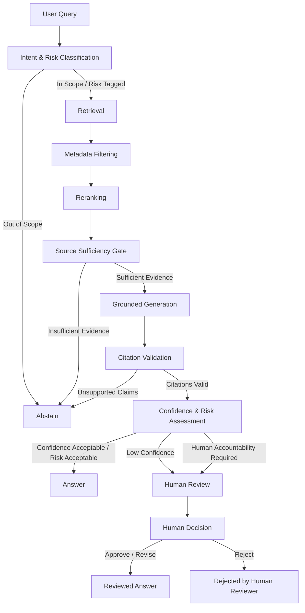

# Governed Agentic RAG

> A work-in-progress architecture for evidence-grounded, evaluated and governable agentic RAG systems.

## Project Status

**Status:** Active development

This repository documents the design and incremental implementation of a governed Agentic RAG system.

The project is intentionally being built in **documented stages**. Architecture, evaluation criteria and governance controls are defined alongside implementation so that design decisions, trade-offs and system evolution remain traceable.

---

## Roadmap

Each component ships with unit tests and is evaluated against the baseline before the next phase begins.

### Phase 0 — Foundations

- [x] Repository structure, Python tooling and CI
- [x] Define public reference corpus ([ADR 0001](docs/adr/0001-public-reference-corpus.md))
- [x] LangGraph skeleton with typed state

### Phase 1 — Baseline and Evaluation

- [ ] Define evaluation dataset covering answerable, unanswerable, ambiguous and high-risk queries
- [ ] Implement baseline RAG as the control group
- [ ] Build evaluation suite
- [ ] Record baseline metrics

### Phase 2 — Retrieval Quality

- [ ] Add intent and risk classification with out-of-scope routing
- [ ] Add metadata-aware retrieval
- [ ] Add reranking
- [ ] Evaluate retrieval improvements against baseline

### Phase 3 — Governance Controls

- [ ] Add source-sufficiency gate
- [ ] Implement explicit abstention path
- [ ] Add grounded generation with claim-level citations
- [ ] Add citation validation
- [ ] Add confidence and risk assessment
- [ ] Implement human-review escalation
- [ ] Evaluate governance behavior against baseline

### Phase 4 — Production Readiness

- [ ] Add FastAPI service layer
- [ ] Add Docker environment
- [ ] Add tracing and operational observability
- [ ] Add integration tests and failure-path tests

### Phase 5 — Results

- [ ] Publish baseline vs. governed evaluation report
- [ ] Document failure modes and limitations
- [ ] Publish architecture case study

---

## Problem

Standard RAG systems can produce fluent answers even when retrieval quality is weak, evidence is insufficient or the query requires explicit human accountability.

This project explores how to design a RAG system in which:

- retrieval quality is explicitly evaluated;
- insufficient evidence leads to abstention;
- high-risk decisions can require human review;
- generated claims remain traceable to their supporting sources;
- failure paths are explicit;
- system behavior is observable;
- evaluation and governance are architectural concerns rather than post-deployment additions.

---

## Planned Architecture



### Why risk classification happens early

Intent and risk classification establish system boundaries before expensive downstream processing begins.

The classifier can immediately route **out-of-scope queries** to abstention.

For supported queries, risk is carried forward as part of the system state rather than automatically sending high-risk requests directly to a human reviewer.

This allows retrieval, reranking and grounded generation to proceed first, so that a reviewer receives:

- the original query;
- retrieved evidence;
- source references;
- the generated draft;
- confidence information;
- the identified risk context.

The human reviewer therefore evaluates an evidence package rather than starting the investigation from scratch.

---

## Abstention, Human Review and Human Rejection

These are deliberately modeled as separate terminal behaviors.

### Abstention

The system abstains when it cannot support an answer with sufficient evidence.

Typical causes include:

- out-of-scope queries;
- insufficient retrieval coverage;
- missing authoritative sources;
- unsupported generated claims;
- failed citation validation.

Abstention is primarily an **evidence-sufficiency outcome**.

### Human Review

Human review is triggered when evidence may be sufficient, but automated completion is inappropriate because uncertainty, risk or accountability requires explicit human judgment.

Typical causes include:

- high-risk decisions;
- policy-sensitive requests;
- conflicting credible evidence;
- low-confidence outputs above the evidence-sufficiency threshold;
- workflows where automated decision authority is inappropriate.

Human review is primarily an **accountability and risk-control mechanism**.

### Human Rejection

A reviewer may determine that the proposed answer should not be released.

This is recorded separately from abstention because:

> **the system failing to establish sufficient evidence is not the same event as a human expert rejecting an evidence-backed draft.**

The distinction matters for evaluation, auditing and incident analysis.

---

## Design Principles

### Evidence before generation

The system should not provide an authoritative answer when the available evidence does not support one.

### Explicit system boundaries

The architecture should make clear:

- what the system can answer;
- what it should abstain from answering;
- what requires human intervention.

### Evaluation alongside implementation

New components should be evaluated against an established baseline rather than added without evidence that they improve system behavior.

### Governance by design

Traceability, abstention, human oversight, auditability and failure handling are part of the architecture.

### Production over demos

Testing, failure handling, configuration management, observability and deployment concerns are introduced during development rather than appended after the prototype is complete.

### Human accountability remains explicit

Automation should not obscure who owns a high-impact decision, approval or rejection.

---

## Planned Evaluation Framework

In this repository, human review is simulated. Review-related metrics are computed against expected-routing labels in the evaluation dataset rather than against production reviewer behavior.

Each evaluation example will include an expected terminal route where applicable:

- `answer`
- `abstain`
- `human_review`

The evaluation layer will separate system quality into distinct dimensions.

### Retrieval

- Recall@k
- Precision@k
- source coverage
- reranking improvement

### Generation

- answer correctness
- groundedness
- completeness
- unsupported-claim rate

### Citations

- citation correctness
- citation completeness
- claim-to-source alignment

### Abstention

- abstention precision
- abstention recall
- false-answer rate under insufficient evidence

### Human Review Routing

- human-review routing precision
- human-review routing recall
- unnecessary-escalation rate
- missed-escalation rate

### Simulated Human Decision

- expected-route accuracy
- inappropriate automatic-answer rate
- inappropriate abstention rate
- escalation correctness

### Operations

- end-to-end latency
- retrieval latency
- model latency
- cost per query
- failure rate

---

## Planned Repository Structure

```text
governed-agentic-rag/
│
├── README.md
├── pyproject.toml
├── Dockerfile
├── docker-compose.yml
├── .env.example
│
├── src/
│   └── governed_rag/
│       ├── __init__.py
│       ├── orchestration/
│       ├── classification/
│       ├── retrieval/
│       ├── generation/
│       ├── evaluation/
│       ├── governance/
│       ├── observability/
│       └── api/
│
├── tests/
│   ├── unit/
│   ├── integration/
│   └── evaluation/
│
├── configs/
│
├── data/
│   ├── corpus/
│   │   └── manifest.toml
│   └── sample/
│
├── docs/
│   ├── ARCHITECTURE.md
│   ├── EVALUATION.md
│   ├── GOVERNANCE.md
│   ├── SECURITY.md
│   └── adr/
│       ├── README.md
│       ├── 0001-public-reference-corpus.md
│       └── 0002-low-confidence-routing.md
│
├── scripts/
│
└── .github/
    └── workflows/
```

---

## Planned Documentation

### `ARCHITECTURE.md`

System components, state transitions, routing logic, dependencies and failure modes.

### `EVALUATION.md`

Evaluation dataset design, metrics, baselines, regression testing and acceptance criteria.

### `GOVERNANCE.md`

Risk classification, abstention, human oversight, human rejection, auditability and accountability controls.

### `docs/adr/`

Architecture Decision Records documenting consequential design and technology choices as they are made.

`docs/adr/README.md` is the ADR index. ADRs are numbered in the order decisions are made.

ADR 0001 records the choice of public reference corpus (NIST AI RMF 1.0 and the Generative AI Profile), including license and attribution.

ADR 0002 will document the decision to route low-confidence outputs to human review rather than immediate abstention after evidence sufficiency has already been established.

### `SECURITY.md`

Threat boundaries, secrets handling, access assumptions and security considerations.

---

## Development Approach

The project will evolve incrementally:

1. establish the engineering and evaluation foundations;
2. create a measurable baseline;
3. improve retrieval quality;
4. introduce governance controls;
5. evaluate each change against the baseline;
6. productionize the service;
7. document results, failures and trade-offs.

The objective is not simply to demonstrate that the system can answer questions.

The objective is to make its behavior **measurable, explainable, traceable and controllable**.

---

## Data and Confidentiality

This project will use **public or synthetic data only**.

No confidential client, institutional or operational data, source code or internal documentation will be included.

The architecture may reflect general engineering lessons developed through professional experience, but the implementation in this repository is independent.

---

## Author

**Ana Camila Bernardes**

Applied AI Lead | GenAI & Agentic AI | Production ML & MLOps | AI Governance

[LinkedIn](https://www.linkedin.com/in/ana-camila-bernardes)
